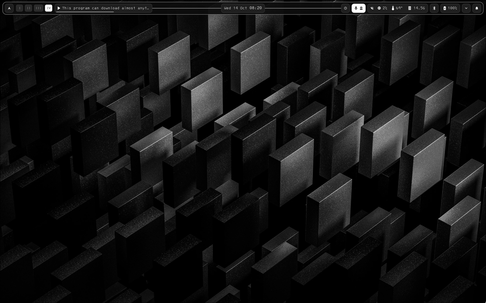
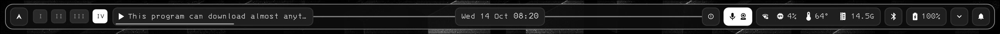
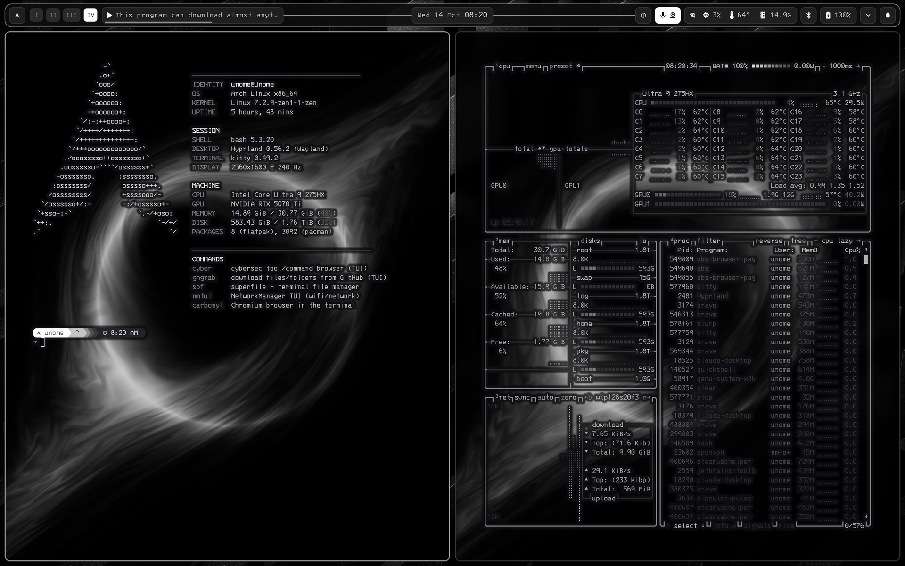
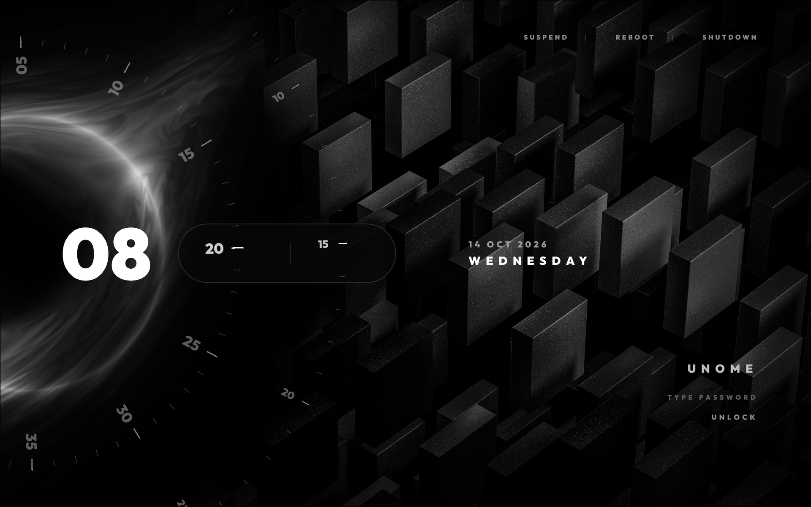

<p align="center"></p>
<p align="center"><b>ARCH · HYPRLAND · MONO</b><br>a black &amp; white desktop, built by hand, one piece at a time<br>
<a href="https://magginephew.github.io/magginephew-rice/">website</a> · <a href="https://twitch.tv/magginephew_gaming">twitch</a></p>



## What's inside

| | |
|---|---|
| **Hyprland** | Lua config, monochrome look, scroll-to-switch workspaces, scratchpad, games keep full speed on other workspaces |
| **Quickshell bar** | hand-written QML: workspaces, clock with a music-reactive line, CPU / RAM / network, Wi-Fi, VPN, update badge, mic/camera privacy light |
| **Media player** | cover, controls, seek, volume, output-device picker (scroll / arrows / Enter), pull-out library + downloader |
| **Local music** | mpv-based player and library, downloader that tags songs (MusicBrainz + Cover Art Archive), Brave extension to add the YouTube song you're on |
| **Soundboard + Rice Mic** | virtual mic = your mic + clips + any app you share; works in Discord, games, calls; `Super+Alt+1–9` plays clips |
| **Start menu / calendar / clipboard** | Windows-style menu on the Arch logo, calendar on the clock, clipboard history with image previews (`Super+C`) |
| **Orbital lock + login** | the same animated lock for boot (SDDM) and `Super+L` (Quickshell) |
| **MonoBW theme** | KDE/Qt colour scheme + light-gray folder icons so Dolphin and Qt apps match |
| **`cyber`** | terminal browser for BlackArch tools with mouse support and a firejail sandbox (online / offline) |
| **`safe-update`** | snapshot → update that survives a desktop crash → checks kernel / initramfs / NVIDIA / boot menu → repair or roll back |
| **`rice-system-setup`** | snapper snapshots before every update, Limine boot entries, deny-incoming firewall |
| **Stream kit** | OBS scenes + browser overlays: starting / BRB / ending screens, camera frame, follower alerts, live counters, chat, in-game scene hotkeys |

## Screenshots



| | |
|---|---|
|  |  |

## Layout

```
config/hypr/            hyprland.lua, hypridle, hyprlock, colours
config/quickshell/      the bar (shell.qml), its scripts, lock screen (lock/)
config/kitty, cava, fastfetch, foot, qt6ct, starship.toml, kdeglobals, dolphinrc
local/share/            MonoBW colour scheme, MonoFolders icons, music, soundboard, cyber
sddm/orbital/           login screen theme (install.sh copies it into /usr/share/sddm/themes)
bin/                    my scripts -> ~/.local/bin
stream-overlays/        OBS browser overlays + scene collection
wallpapers/             wallpapers (daily/ = the daily rotation)
docs/                   this project's website (GitHub Pages)
```

## Keys

| keys | does |
|---|---|
| `Super+Enter` / `Space` / `E` / `B` | terminal / launcher / files / browser |
| `Super+Q` · `F` · `V` | close · fullscreen · float |
| `Super+1–5` (`+Shift`) | workspace (move window) |
| `Super+S` | scratchpad |
| `Super+L` · `R` | lock · reload Hyprland |
| `Super+C` · `N` · `W` | clipboard · notifications · next wallpaper |
| `Print` (`Super`, `Super+Shift`) | screenshot region + edit (save, whole screen) |
| `Super+Alt+1–9` / `0` | soundboard clip / stop |
| `Super+Ctrl+1–5` · `M` · `↑↓` | OBS scene · mute mic on stream · stream music volume |

## Use it

These are my personal dotfiles, not an installer — take what you like and **back up your own configs first**.

```sh
git clone https://github.com/MaggiNephew/magginephew-rice
cd magginephew-rice
cp -r config/hypr config/quickshell config/kitty config/cava ~/.config/
cp bin/* ~/.local/bin/
```

Packages: `hyprland quickshell kitty cava pipewire wireplumber pipewire-pulse playerctl brightnessctl cliphist wl-clipboard mpv mpv-mpris yt-dlp python-mutagen firejail snapper snap-pac qt6ct dolphin fastfetch starship ttf-3270-nerd awww hypridle`
(+ `obs-studio` from Flatpak for the stream kit, `pacman-contrib` for the update badge.)

Some scripts are tied to my hardware (an Acer Predator laptop: `predator-mode`, `lid-guard`) — skip those on other machines.

## Wallpapers

In [`wallpapers/`](wallpapers). The ones in `wallpapers/daily` rotate one per day (`wallpaper-daily`); `Super+W` skips to the next.

## Credits

- Lock / login screen adapted from the clockwork/orbital theme of [qylock](https://github.com/Darkkal44/qylock) by Darkkal44 (GPL-3.0, see `config/quickshell/lock/LICENSE-qylock`); font Outfit (SIL OFL)
- cava shaders by rezky_nightky (MIT)
